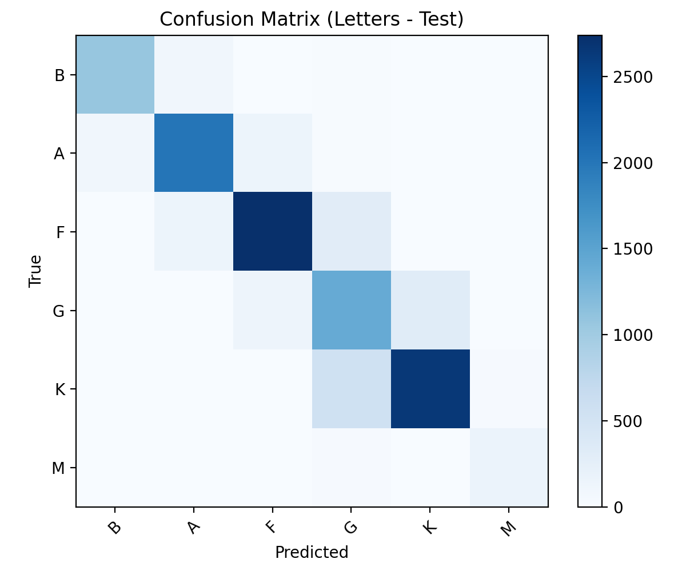

# Star Cataloguing Deep Learning Model

A catalog-driven deep-learning pipeline that classifies stars from RGB image cutouts. The model
predicts the Morgan–Keenan spectral letter (O, B, A, F, G, K, M — the shipped checkpoint resolves
six of them, see [Trained weights](#trained-weights)) and the subclass digit (0–9 within
the predicted letter) from photometric imagery alone — no spectra.

Project page: **[loganmedwardsastrophy.com/star-catalog.html](https://www.loganmedwardsastrophy.com/star-catalog.html)**

## Results

Held-out test set: **14,406 samples** (96,039 total across the 70/15/15 split). 27.4% of them have
a copy in training; see [How far the headline holds](#how-far-the-headline-holds).

| Metric | Value |
|---|---|
| Letter top-1 (6-way, see note) | **84.30%** |
| Letter top-2 | **98.41%** |
| Letter macro F1 | 0.8455 (precision 0.8467 / recall 0.8479) |
| Subclass top-1 (10-way digit) | 30.62% |
| Subclass top-2 | 51.50% |
| Combined exact (letter + digit) | 30.15% |

<p align="center">
  
</p>

The letter head is the headline number: it tracks the macroscopic temperature sequence robustly.
Subclass resolution is intrinsically harder, because RGB cutouts encode colour differences only
coarsely. Raw values are in [`results/test_metrics_summary.json`](results/test_metrics_summary.json).

### How far the headline holds

The test set is not fully independent of training. Class balancing resamples the minority letters
with replacement *before* the split, so copies of one image land in both train and test (see
[Data](#data)). 27.4% of the test images have an identical copy in training.

As an independent check, the shipped model was scored (2026-10-11) on stars it never saw. The Kaggle
download carries a second, smaller bundle, and 17,672 of its stars lie more than 10″ from every star
in the cleaned bundle, the published form of the training data. (The exact training zip is not
published, so a few overlaps cannot be ruled out.) On the A, B, F and G stars among them, which
match the training data in brightness, it gets **82.3% top-1** (5,717 of 6,944), with recall A
86.5%, B 88.0%, F 85.0% and G 71.7%. So for the population it was trained on, the letter head generalises roughly as the
headline suggests. That bundle's K and M stars are a different population: median Gaia G ≈ 19–20 mag
against ≈ 8.5 in training, with dimmer, bluer cutouts. The model mostly calls them G (K recall 45.5%,
M 23.5%), so it has not learned faint stars. Across all 17,672 the figures are 59.4% top-1, 66.7%
class-balanced and 91.8% top-2.

[`results/`](results) also holds the letter-head training curves
([`training_curves_letters.png`](results/training_curves_letters.png)), the overall multi-task curves
([`training_curves_overall.png`](results/training_curves_overall.png)), and the full-resolution
combined letter × subclass confusion matrix
([`confusion_matrix_combined_test.png`](results/confusion_matrix_combined_test.png)).

Confusion concentrates at decision boundaries that are *physically* adjacent — A/F, F/G and G/K, all
neighbours in the H–R diagram — and subclass errors are locally smooth, typically off by ±1. The
combined confusion matrix is block-diagonal: errors cluster within a letter far more than they cross
letter boundaries, which is what you would expect from a model that has learned temperature as a
continuous quantity rather than a set of independent classes.

## Pipeline

| Stage | Script | Notebook | What it does |
|---|---|---|---|
| 1. Catalogue + image builder | [`src/build_star_dataset.py`](src/build_star_dataset.py) | [`01_catalogue_and_image_builder`](notebooks/01_catalogue_and_image_builder.ipynb) | Queries VizieR (Gaia DR3, HIPPARCOS, PS1, WISE, …) for coordinates, magnitudes, colours and spectral hints; fetches colour cutouts from Pan-STARRS with fallbacks; recentres, stretches and magnitude-scales each frame; rejects grayscale or low-quality frames; packs images + `metadata.csv` into a bundle. |
| 2. Multi-task CNN | [`src/train_star_cnn.py`](src/train_star_cnn.py) | [`02_star_classification_cnn`](notebooks/02_star_classification_cnn.ipynb) | Staged training of the three-head CNN, then confusion matrices, training curves, derived-label CSVs and test metrics. |
| 3. Inference | [`src/infer_stars.py`](src/infer_stars.py) | [`03_cnn_utilization`](notebooks/03_cnn_utilization.ipynb) | Loads the trained model, applies training-identical preprocessing to new cutouts, and decodes letter + subclass predictions (with ground-truth comparison when a metadata CSV is supplied). |

## Model

A compact, regularized ConvNet: four `Conv(3×3) → BatchNorm → ReLU` blocks (32 → 64 → 128 → 256
channels, max-pooling after the first three) feed global average pooling and a shared
`Dense(256) → BatchNorm → ReLU → Dropout(0.3)` trunk. Each of three softmax heads sits behind its own
small dense layer:

- **Letter head** — softmax over the spectral letters present in the training set.
- **Combined head** — softmax over `letter × 10 + subclass`, so the model learns letter-specific
  subclass boundaries from a single classifier.
- **Stage head** — auxiliary softmax over evolutionary stage (white dwarf / main sequence / subgiant
  / giant / supergiant / unknown).

Training is two-stage. Stage 1 trains the whole network on the letter loss alone (the other losses
are weighted 0) to establish a stable backbone. Stage 2 adds the combined-head loss at equal weight
and a lower learning rate. Nothing is frozen in either stage. Class balance is handled by curved
resampling plus class-balanced sample weights, and the 70/15/15 split is stratified on letter. Adam
with plateau-triggered LR reductions and early stopping with best-weight restoration (patience 20)
guards against overfitting.

Letters come from the catalogue spectral types in the bundle's `metadata.csv`; the script's
colour-temperature fallback only runs when the metadata yields too few labels. Subclass digits come
from the catalogue where present. Otherwise the script estimates them from the image's own colour
temperature within the letter's range, or sets 5 at half weight.

> **On the stage head:** it never trained. The builder computes a `stellar_stage` for each star but
> leaves it out of the bundle's `metadata.csv`, so every training label was `unknown`, and the
> script then weights the stage loss at 0 (the shipped model's saved compile config confirms it). It
> is excluded from the metrics. "Combined" throughout means letter + subclass digit; stage is not
> part of it.

## Data

The raw class distribution is steeply imbalanced — K and F dominate, M is rare — so the training
script applies a "curved" target distribution that softens the skew without discarding the long
tail. It resamples each letter to `count^0.6`, rescaled to keep the total:

| Letter | Before balancing | After balancing |
|---|---|---|
| K | 30,901 | 26,154 |
| F | 30,117 | 25,754 |
| A | 17,127 | 18,356 |
| G | 12,072 | 14,881 |
| B | 5,537 | 9,322 |
| M | 285 | 1,572 |

Splits: 67,227 train / 14,406 validation / 14,406 test, totalling the same 96,039.

The report's tables and earlier versions of this README also listed **O, 78 → 283**. That row does
not belong to this run. Running the script's balancing on the six counts above reproduces the "after"
column exactly; with an O row of 78 included, every target changes (O itself would get 718). Both
columns also total 96,039, the split total, which the old O row broke (96,117 before, 96,322 after).

**Train/test overlap.** Letters with fewer images than their target are drawn *with replacement*
(M's 285 images become 1,572 samples), and this happens before the split. Exact copies of one image
can therefore sit in both train and test. Replaying the script's seeded resampling and splits with
the counts above reproduces the published split sizes exactly. It shows that 3,944 of the 14,406
test images (27.4%) have an identical copy in training: M 97.9%, B 66.8%, G 58.7%, A 53.3%, and F
and K 0%, since those two were only downsampled. The independent check under
[Results](#how-far-the-headline-holds) suggests the effect on bright A–G stars is modest. Fixing it
means resampling after the split and retraining.

**Quality gates:** minimum peak intensity and peak-to-background ratio; maximum centroid offset from
frame centre; maximum saturated-pixel fraction; grayscale detection (RGB channels must carry
independent information).

The prepared image bundle is on Kaggle:
**[loggger/star-image-bundles](https://www.kaggle.com/datasets/loggger/star-image-bundles)**.

## Trained weights

[`models/star_rgb_cnn_staged_combined.keras`](models/star_rgb_cnn_staged_combined.keras) (6.5 MB) is
the trained multi-task model that produced the metrics above. Inspecting it:

| | |
|---|---|
| Input | 64 × 64 × 3 |
| `letter_output` | **6** units |
| `combined_output` | **60** units (6 letters × 10 subclasses) |
| `stage_output` | 6 units |

**On the missing O class.** This run's label space has six letters — B, A, F, G, K, M — not seven.
`confusion_matrix_letters_test.png` is a 6 × 6 matrix and the combined head is 60-wide, both
consistent with the checkpoint. This run had no O stars at all (see [Data](#data)), and the
published Kaggle bundle has none either; O stars are rare in the source catalogues (the bundle's
second, smaller set has 4 among 19,729). The headline 84.30% is therefore a 6-way number. A separate
7-letter / 70-combined checkpoint does exist from an earlier, smaller-dataset run, but its metrics
are not the ones reported here, so it is not the one shipped.

**On letter order.** The script's `LabelEncoder` sorts the letters, so the letter head's outputs are
in the order A, B, F, G, K, M, not the B, A, F, G, K, M order the confusion matrix is drawn in.
Scored against catalogue labels on 2,770 stars from the cleaned bundle, that order agrees on 83.6%,
the best of all 720 possible orders; B, A, F, G, K, M agrees on 53.1%. The model file does not record
the order; `src/infer_stars.py` now does.

**On input resolution.** The checkpoint takes 64 × 64 input. The notebook was last left at
`IMG_SIZE = (256, 256)`, so `src/train_star_cnn.py` sets it to `(64, 64)` to match what ships —
raise it to train at higher resolution. `src/infer_stars.py` reads the input size off the loaded
model, so inference adapts automatically either way.

**On epochs.** The shipped run trained for longer than the script's `EPOCHS = 100` allows. Stage 1
gets `EPOCHS // 3` epochs, and `training_curves_letters.png` shows stage 1 running 57 of them before
stage 2 begins, so that run used `EPOCHS` of at least 171.

## Running it

Use Python 3.10–3.13 (as of TensorFlow 2.21 there are no wheels for 3.14). The shipped model was
saved with Keras 3.10, so loading it needs TensorFlow 2.16 or newer, the first release built on
Keras 3.

```bash
pip install -r requirements.txt
```

Build a dataset from the catalogues (network-bound; start small):

```bash
python src/build_star_dataset.py --nstars 1000 --size 256 --out-images-zip star_images_bundle.zip
```

Train. The training script reads `star_images_bundle.zip` from the working directory and loads
every image inside it. The Kaggle download holds two bundles side by side,
`star_images_bundle (CLEANED)/` and a smaller `star_images_bundle(small)(NEWish)(20000)/`, whose
file names overlap, so **zip one bundle's `dataset/` folder on its own as `star_images_bundle.zip`**
rather than renaming the download:

```bash
python src/train_star_cnn.py
```

Run inference on an image or a folder — edit the paths at the top of the script first. It prints a
letter + subclass prediction per image (e.g. `G2`), and the ground truth alongside when
`GROUND_TRUTH_CSV` points at a bundle's `metadata.csv`:

```bash
python src/infer_stars.py
```

## Limitations & future work

- **RGB-only inputs.** Spectral subclass boundaries are intrinsically fuzzy in three-band photometry,
  and are confused further by interstellar reddening.
- **Saturation & centring.** Performance is sensitive to data hygiene; quality gates exist, but
  borderline frames still leak through.
- **Rare classes.** O is absent from this run and M is limited by raw availability even after
  balancing. Targeted sampling or modest augmentation would help, provided the resampling happens
  after the split (see [Data](#data)).
- **Next directions.** Calibrated photometry, extinction estimates, NIR bands, and attention pooling
  over radial profiles are the most promising routes to sharper subclass resolution.

## Repository layout

```
src/         runnable stage scripts
notebooks/   the original Colab notebooks (outputs stripped)
results/     confusion matrices, training curves, test metrics
models/      trained .keras model
docs/        full technical report (PDF)
```

### Provenance

`notebooks/` holds the original Colab notebooks verbatim, with execution outputs stripped and
nothing else changed. `src/` is the same code lifted out of those cells, with the Colab-only cells
left behind:

- `build_star_dataset.py` omits the notebook's opening `pip install` bootstrap cell — that is what
  `requirements.txt` is for.
- `infer_stars.py` omits the trailing `drive.mount('/content/drive')` cell, which only does anything
  inside Colab.

One edit makes training match the shipped checkpoint:

- `train_star_cnn.py` — `IMG_SIZE` is `(64, 64)` rather than the `(256, 256)` the notebook was last
  left at, so the script matches the 64 × 64 checkpoint in `models/`.

Three more fix bugs; the notebooks keep the original behaviour:

- `build_star_dataset.py` — `timed_forward_torch` defaulted its `dtype` argument to `torch.float32`.
  Defaults are evaluated when the function is defined, so without torch installed the builder died
  on import (`'NoneType' object has no attribute 'float32'`), although torch is meant to be
  optional. The default is now set inside the function.
- `infer_stars.py` — letters are named in the shipped model's encoder order (A, B, F, G, K, M).
  Before, with no `classes.json` (which nothing writes), predictions printed as `IDX0`–`IDX5`, or a
  letter mapping was fitted to the very ground truth they were then compared with. With a batch
  covering only some letters, that forced every prediction into those letters. The ground-truth
  remap now runs only when the order is unknown (a model with a different letter count).
- `infer_stars.py` — images are resized with Lanczos, as in training, instead of `load_img`'s
  nearest-neighbour default.

Every other line matches the notebooks. The scripts already used relative paths, so nothing else
needed changing.

## Report

[`docs/Spectral_Identification_Model_Report.pdf`](docs/Spectral_Identification_Model_Report.pdf) —
full methodology, dataset construction, and error analysis.

The report mixes runs, so where it disagrees with this README, the README follows the shipped model
and `results/`. Its class tables carry the O row discussed under [Data](#data). Its figure page
includes a subclass matrix for O and training curves with a different epoch count. Its subclass
top-2 (0.541) differs from `test_metrics_summary.json` (0.5150). It also calls the backbone
three-block and describes an inference CSV with confidence scores, which the script does not write.

## License

MIT — see [LICENSE](LICENSE).
